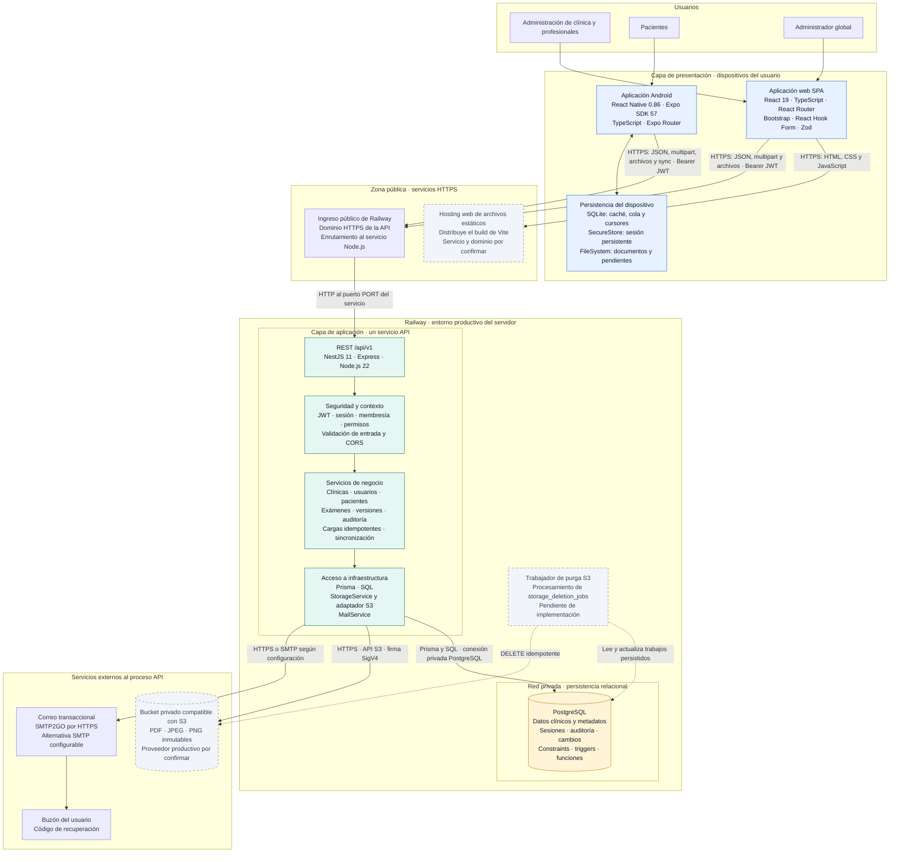
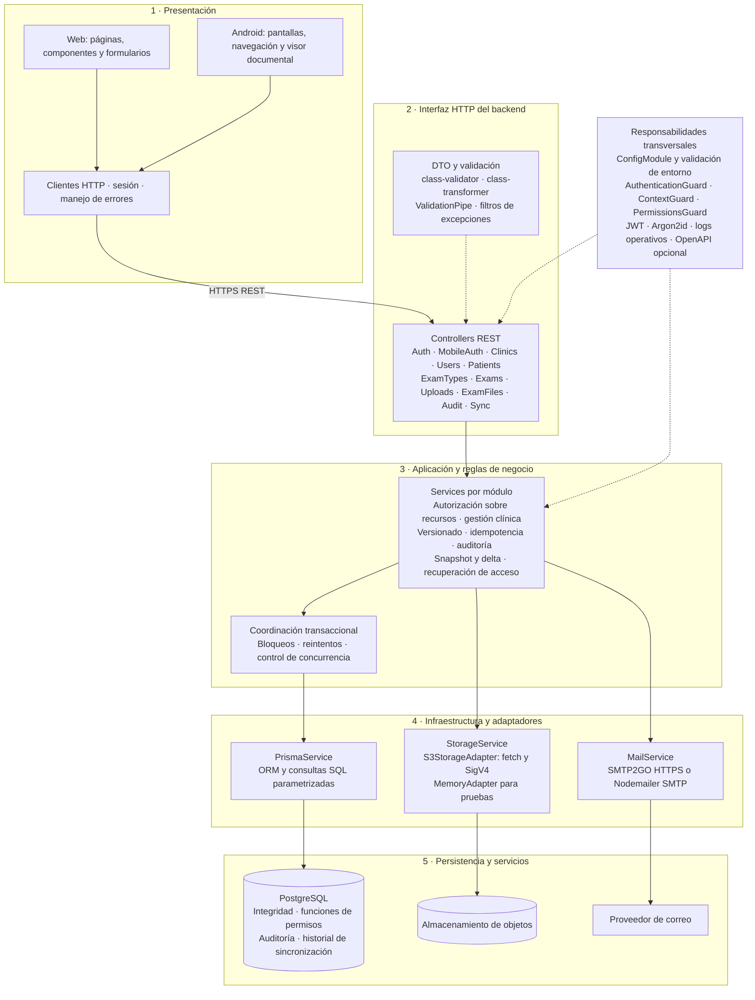
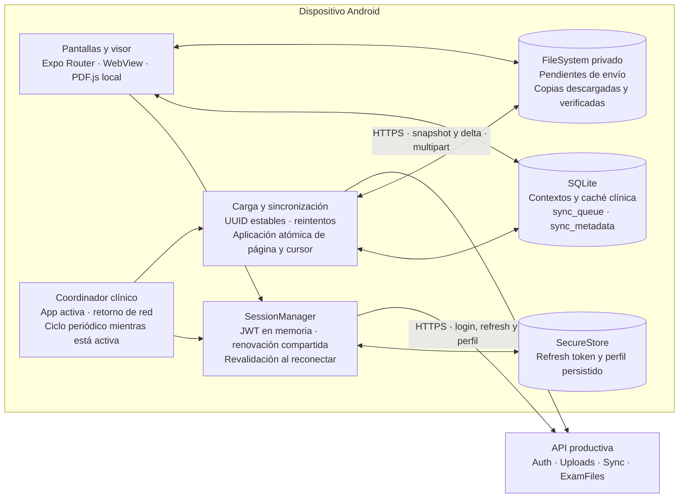
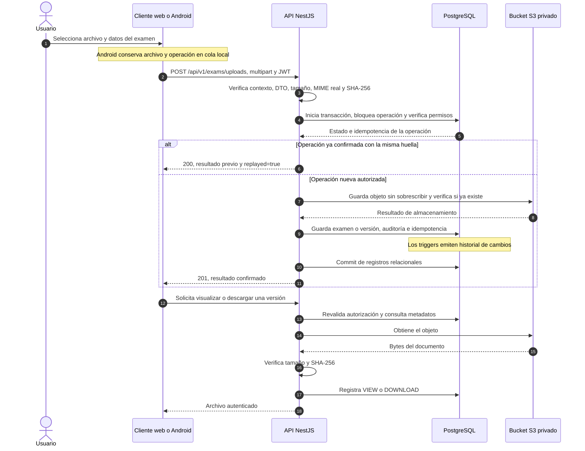
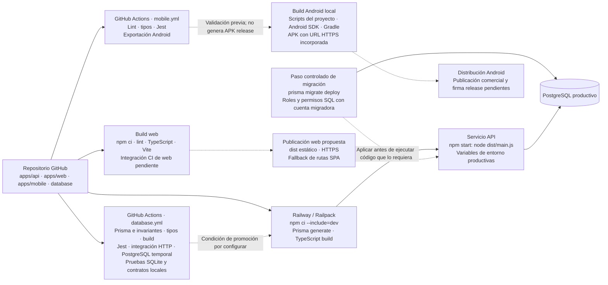

# Arquitectura de software y despliegue productivo — WellQ

**Proyecto:** gestión documental clínica multitenant · **Fecha:** 11 de noviembre de 2026 · **Referencia:** código y configuración versionados del repositorio.

## 1. Alcance y criterio de lectura

WellQ utiliza una arquitectura cliente–servidor con **backend monolítico modular**, organizado en capas, y dos aplicaciones cliente: una web para gestión clínica y una Android para pacientes. PostgreSQL conserva los registros y metadatos; un almacenamiento compatible con S3 conserva los documentos. Android dispone de persistencia y sincronización para uso sin conexión.

Este documento describe la implementación y su distribución prevista en producción. No constituye una inspección de los servicios remotos. **Implementado** significa que existe código; **documentado** significa que las guías registran el despliegue; **propuesto** significa que falta confirmar o completar su operación productiva. La existencia de un módulo no demuestra que su última versión esté desplegada.

En caso de diferencias con documentos antiguos, se priorizan el código ejecutable, los manifiestos y la configuración de arranque. No se presuponen microservicios, Kubernetes, Redis, un API Gateway dedicado ni colas de mensajería externas.

## 2. Vista principal: arquitectura productiva

Las zonas representan ubicaciones de ejecución y límites de confianza. Las flechas indican la dirección de inicio de una comunicación; las respuestas regresan por esa misma conexión. Los nodos grises son componentes propuestos o cuya operación no está confirmada.

**Ubicación y estado:** la API y PostgreSQL están documentados en Railway. El dominio de API registrado es `https://capstone005v-production.up.railway.app/api/v1`; no se verificó su disponibilidad en esta revisión. La web tiene código funcional, pero no se encontró configuración versionada de hosting productivo. El adaptador S3 está implementado y admite un endpoint configurable; no se atribuye el bucket a AWS, Cloudflare u otro proveedor sin evidencia. MinIO y Mailpit aparecen en Docker Compose para desarrollo local.

El tráfico documental atraviesa la API: los clientes no acceden directamente a PostgreSQL ni reciben credenciales del bucket. No se implementa aquí una distribución de documentos mediante enlaces S3 prefirmados. El ingreso HTTPS es una función de la plataforma; no representa un gateway desarrollado por el proyecto.

## 3. Vista de capas y dependencias internas

Las capas siguientes son responsabilidades lógicas dentro del mismo proceso API. La separación no implica procesos independientes ni una implementación estricta de Clean Architecture: los servicios de negocio usan Prisma directamente y, en algunos casos, SQL y funciones de PostgreSQL.

| Capa | Responsabilidad | Implementación principal |
|---|---|---|
| Presentación web | Gestión de pacientes, miembros, exámenes, documentos y auditoría; formularios y navegación protegida | `apps/web/src/pages`, `components`, `context` y `lib` |
| Presentación móvil | Acceso de pacientes, consulta documental, cargas, visor y operación offline | `apps/mobile/app` y `apps/mobile/src` |
| Interfaz HTTP | Rutas, contratos de entrada y salida, recepción de archivos y traducción de errores | Controllers y DTO de `apps/api/src/modules`; `config/application.ts` |
| Aplicación | Casos de uso, permisos sobre entidades, transacciones, versiones, sincronización y recuperación | Services de `apps/api/src/modules` |
| Infraestructura | PostgreSQL, objetos, correo y configuración | `prisma`, módulos `storage` y `auth/mail.service.ts` |
| Persistencia | Relaciones, invariantes, historial, auditoría y funciones SQL | `apps/api/prisma`, `database/postgresql` y `database/sqlite` |

## 4. Tecnologías del proyecto

Las versiones son familias o rangos declarados en los manifiestos, no una certificación del software instalado en producción. Los archivos `package-lock.json` fijan las dependencias de cada instalación reproducible.

| Área | Tecnologías | Función |
|---|---|---|
| Web | React 19, TypeScript 6, Vite 8, React Router 7 | SPA, navegación y compilación de recursos estáticos |
| Interfaz web | Bootstrap 5, React Bootstrap, React Hook Form 7, Zod 4 | Componentes, formularios y validación del cliente |
| Android | React Native 0.86, React 19, Expo SDK 57, Expo Router | Aplicación nativa y navegación |
| Persistencia Android | Expo SQLite, Expo SecureStore, Expo FileSystem | Caché y cola; sesión persistente; archivos privados |
| Documentos Android | PDF.js 6, React Native WebView, Expo DocumentPicker, Expo Crypto | Visualización, selección de archivos e integridad SHA-256 |
| API | Node.js 22, TypeScript 5, NestJS 11, Express | Servicio HTTP y módulos de negocio |
| Contratos HTTP | REST, JSON, multipart/form-data, OpenAPI/Swagger | Datos estructurados, cargas y documentación |
| Validación API | class-validator, class-transformer | Validación de DTO y rechazo de propiedades no admitidas |
| Identidad | JWT HS256, Argon2id, SHA-256, HMAC | Tokens de acceso, hashes de contraseña, integridad y firmas |
| Datos relacionales | PostgreSQL; Prisma ORM/Client 5 | Consultas, transacciones y migraciones; PostgreSQL 16 en desarrollo y CI |
| Objetos | API S3, adaptador propio con fetch y firma SigV4 | PUT condicional, lectura y eliminación de documentos |
| Correo | SMTP2GO HTTPS; Nodemailer 10 como alternativa SMTP | Recuperación de acceso |
| Plataforma | Railway, Railpack, npm | Construcción y ejecución de la API y alojamiento documentado de PostgreSQL |
| CI | GitHub Actions, Jest, Supertest, Testing Library, Python, ESLint | Pruebas, tipos, integridad y exportación Android |
| Calidad web | Oxlint, TypeScript, Vite build | Lint y compilación; sin workflow web dedicado en lo revisado |
| Desarrollo local | Docker Compose, PostgreSQL 16, MinIO y Mailpit | Base local, objetos y captura de correo |

## 5. Arquitectura de Android y sincronización

La fuente de verdad remota es PostgreSQL. SQLite conserva una réplica parcial autorizada, separada por propietario y clínica. Las operaciones pendientes y sus archivos se preservan hasta confirmarse o resolverse explícitamente. No se considera la cola local una cola de trabajos del servidor.

La primera sincronización obtiene un snapshot; las posteriores aplican cambios incrementales y tombstones mediante un cursor firmado, ligado al usuario, clínica y revisión de permisos. Un cambio de permisos puede exigir reconstruir el snapshot. Los cambios y el cursor se guardan juntos en una transacción local.

El coordinador trabaja mientras la aplicación está activa, al recuperar red y periódicamente. **No representa un servicio Android de sincronización garantizada en segundo plano.** Los documentos offline se descargan por selección y se verifican con SHA-256. El visor PDF incorpora sus recursos al paquete y no necesita un CDN para PDF.js.

La apertura de la base utiliza `database/sqlite/migrate-v3`; el SQL v2 base se complementa con migraciones locales, incluido el catálogo de tipos de examen. El diagrama de arquitectura agrupa esa persistencia por responsabilidad y no sustituye el modelo detallado de tablas.

## 6. Flujo documental de extremo a extremo

El límite funcional por archivo es **10.000.000 bytes**, en PDF, JPEG o PNG. La API recalcula el tamaño, MIME y SHA-256; no confía en las declaraciones del cliente. Una versión confirmada es inmutable.

La transacción SQL coordina las filas, pero **no existe una transacción distribuida atómica entre PostgreSQL y S3**. La implementación realiza la escritura del objeto durante el procesamiento transaccional y usa identificadores estables, escritura condicional y reintentos idempotentes para tolerar interrupciones. Un objeto almacenado antes de fallar el commit puede requerir reutilización verificada o conciliación posterior.

El borrado habitual es lógico. La función de purga SQL conserva auditoría y tombstones y genera trabajos persistidos para eliminar objetos. El trabajador remoto que consumiría esos trabajos permanece pendiente; purgar filas no demuestra que se haya eliminado físicamente el archivo.

## 7. Seguridad y separación multitenant

| Control | Comportamiento implementado y límite |
|---|---|
| Identidad y contexto | JWT Bearer con emisor, audiencia y contexto GLOBAL o TENANT. El contexto clínico se valida en servidor. |
| Autorización | Guards globales de autenticación, contexto y permisos; validación de acceso al recurso en servicios y funciones SQL. |
| Multitenencia | Esquema compartido con `clinic_id`, membresías `UserClinic`, fichas por clínica y FKs compuestas. No hay una base independiente por clínica. |
| Administrador global | No obtiene acceso clínico automático por ser administrador del sistema. |
| Estado de permisos | Se revisan membresías, actividad y versión de credenciales; un paciente histórico puede conservar lectura propia. |
| Contraseñas | Hash Argon2id en backend; no se guardan contraseñas en los clientes. |
| Sesión web | JWT en memoria; se pierde al recargar. El cliente web actual no implementa refresh persistente. |
| Sesión Android | JWT corto de hasta 15 minutos, sesión absoluta de 30 días y refresh rotativo; detección de reutilización. Persistencia mediante SecureStore. |
| Datos offline | Caché separada por usuario y clínica, permisos revalidados online y archivos privados. No se identificó cifrado SQLCipher configurado. |
| Protección de entrada | Validación de DTO, whitelist, rechazo de campos no admitidos y verificación del contenido documental. |
| CORS | Lista explícita de orígenes web en producción; sin configuración, no se permite un origen web. CORS no sustituye la autorización. |
| Almacenamiento | Acceso S3 desde el backend y firma SigV4; endpoint HTTPS y bucket privado previstos para producción. |
| Cuenta SQL | Rol de aplicación `wellq_app` separado del dueño/migrador; su concesión requiere configuración de despliegue. |
| Auditoría | Acciones documentales y administrativas persistidas; restricciones y triggers protegen el historial. |
| Rate limiting | Límites de autenticación y recuperación persistidos en PostgreSQL; no se presupone un WAF ni un limitador global de tráfico. |

PostgreSQL no tiene RLS implementado en este proyecto: el aislamiento depende de la autorización del backend y de las reglas de integridad SQL. El JWT no reemplaza la consulta del estado actual. El descifrado de claims en la web sirve para presentación y navegación; la API verifica la firma y los permisos.

Las variables sensibles se inyectan únicamente en el servidor. Los clientes incorporan solo la URL pública de la API y configuración no secreta. Deben configurarse por separado `DATABASE_URL`, `JWT_SECRET`, `PASSWORD_RESET_SECRET`, `SYNC_CURSOR_SECRET`, credenciales S3 y credenciales del proveedor de correo; aquí no se reproducen sus valores.

## 8. Construcción, validación y despliegue

`apps/api/railway.toml` configura Railpack, instalación, generación de Prisma, compilación y arranque. Railway aporta `PORT`; el proceso escucha ese puerto y habilita cierre ordenado. La política versionada reinicia el servicio ante fallos, hasta tres reintentos.

**Las migraciones no se ejecutan en el arranque actual.** Se aplican con una cuenta migradora, separada de la cuenta de ejecución. Esta lectura sigue `railway.toml`, `package.json` y la guía específica de API; la guía antigua `database/RAILWAY_SETUP.md` propone otra estrategia y no describe el comando de arranque vigente.

Los workflows revisados validan API/persistencia y móvil. No contienen una acción de despliegue Railway ni una garantía versionada de que Railway espere el éxito de CI. La conexión entre repositorio, condiciones de promoción y servicio desplegado requiere configurarse y verificarse en la plataforma.

La web se compila a archivos estáticos; Vite es la herramienta de desarrollo y build, no un servidor productivo definido por este repositorio. El hosting debe resolver las rutas de React Router hacia `index.html`. `VITE_API_URL` se incorpora durante el build y el origen publicado debe figurar en `CORS_ORIGINS` de la API.

El perfil Android productivo exige una URL HTTPS y desactiva el modo demo. Los scripts actuales generan APK con firma de desarrollo; usar una API productiva no convierte el artefacto en una publicación comercial. La exportación de CI tampoco equivale a generar y distribuir un AAB/APK firmado para una tienda.

## 9. Operación productiva: estado y capacidad de evolución

| Aspecto | Estado observado en el repositorio | Implicación operativa |
|---|---|---|
| API y PostgreSQL | Despliegue Railway documentado | Confirmar versión ejecutada y migraciones aplicadas al promover cambios. |
| Web | Aplicación implementada; hosting sin confirmar | Publicar build estático, configurar dominio, fallback SPA, API y CORS. |
| Almacenamiento | Adaptador S3 implementado; proveedor remoto sin confirmar | Configurar bucket privado, permisos y endpoint HTTPS; comprobar compatibilidad del proveedor. |
| Recuperación de acceso | SMTP2GO HTTPS y SMTP implementados | Depende de credenciales válidas y remitente autorizado del proveedor. |
| Purga física | Función SQL y trabajos persistidos; trabajador remoto pendiente | La eliminación de objetos no está automatizada por un consumidor implementado. |
| Observabilidad | Logger de NestJS, errores normalizados y auditoría de negocio | No se encontró una integración de métricas, trazas distribuidas o alertas centralizadas. |
| Salud del servicio | Sin healthcheck específico en `railway.toml` ni módulo dedicado identificado | Definir probes de vida y disponibilidad antes de depender de promoción automática por salud. |
| Respaldo y recuperación | Sin automatización versionada de backups y restauración | Establecer retención, RPO/RTO y pruebas de restauración para BD y documentos. |
| Alta disponibilidad | Sin réplicas, failover o balanceo propios definidos en el repositorio | No se afirma tolerancia a fallos de una instancia o del servicio de datos. |
| Escala de archivos | Archivos limitados a 10 MB y buffers en el proceso API | Dimensionar memoria y concurrencia; S3 y transacciones pueden condicionar latencia y capacidad. |
| Escalamiento API | Estado de sesiones e idempotencia en PostgreSQL | Facilita futuras réplicas, pero exige probar concurrencia, conexiones y configuración de red. |
| Tareas Android | Coordinación en primer plano | No se garantiza envío con la aplicación suspendida o cerrada. |

La evolución puede conservar el monolito modular y añadir el trabajador de purga como proceso independiente. Esa separación se justifica por su ciclo de vida y reintentos, sin exigir convertir todos los módulos de negocio en microservicios. Cualquier capacidad adicional de CDN, cifrado en reposo, backups gestionados o monitoreo debe documentarse una vez configurada y comprobada.

## 10. Fuentes verificables del repositorio

| Evidencia | Qué respalda |
|---|---|
| [Composición de la API](apps/api/src/app.module.ts) | Módulos registrados en el proceso backend |
| [Configuración HTTP](apps/api/src/config/application.ts) | REST, validación, CORS y OpenAPI |
| [Seguridad global](apps/api/src/modules/auth/auth.module.ts) | JWT y guards |
| [Carga documental](apps/api/src/modules/uploads/uploads.service.ts) | Integridad, idempotencia, bloqueos y transacciones |
| [Lectura de archivos](apps/api/src/modules/exam-versions/exam-files.service.ts) | Proxy documental, integridad y auditoría |
| [Interfaz de almacenamiento](apps/api/src/modules/storage/storage.service.ts) y [adaptador S3](apps/api/src/modules/storage/adapters/s3.adapter.ts) | Separación del proveedor y protocolo SigV4 |
| [Correo](apps/api/src/modules/auth/mail.service.ts) | SMTP2GO por HTTPS y alternativa SMTP |
| [Sincronización backend](apps/api/src/modules/sync/sync.service.ts) | Snapshot y delta autorizados |
| [Sesión web](apps/web/src/context/AuthContext.tsx) y [cliente HTTP](apps/web/src/lib/api.ts) | Tokens en memoria y acceso a la API |
| [Persistencia Android](apps/mobile/src/clinical/database.ts) y [coordinador](apps/mobile/src/clinical/lifecycle.ts) | Migraciones locales y ejecución en primer plano |
| [Sesión Android](apps/mobile/src/auth/session.ts) | Renovación y estado de sesión |
| [API](apps/api/package.json), [web](apps/web/package.json) y [móvil](apps/mobile/package.json) | Tecnologías y rangos de versión |
| [Railway](apps/api/railway.toml) y [guía de despliegue](apps/api/RAILWAY.md) | Build, arranque y entorno remoto documentado |
| [CI de API y datos](.github/workflows/database.yml) y [CI móvil](.github/workflows/mobile.yml) | Validaciones automatizadas existentes |
| [Contrato de datos](database/contracts/README.md) y [modelo ER](database/MODELO_BASE_DATOS.md) | Multitenencia, persistencia, auditoría y purga |
| [Docker Compose](docker-compose.yml) | Infraestructura de desarrollo local |

El [diagrama productivo en formato Mermaid independiente](ARQUITECTURA_PRODUCCION.mmd) reproduce la vista principal para incorporarla a informes o herramientas compatibles con Mermaid.
