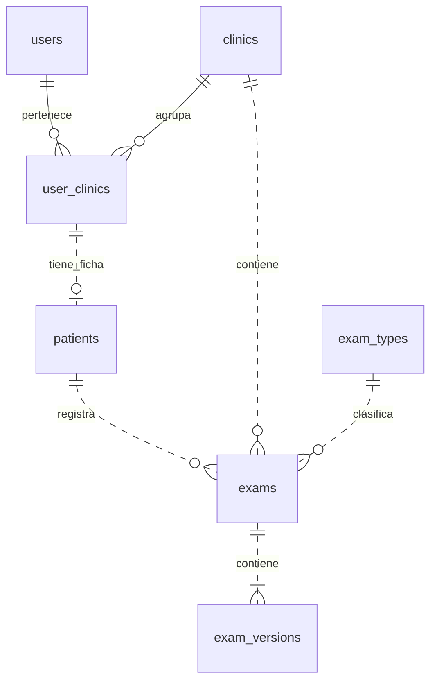
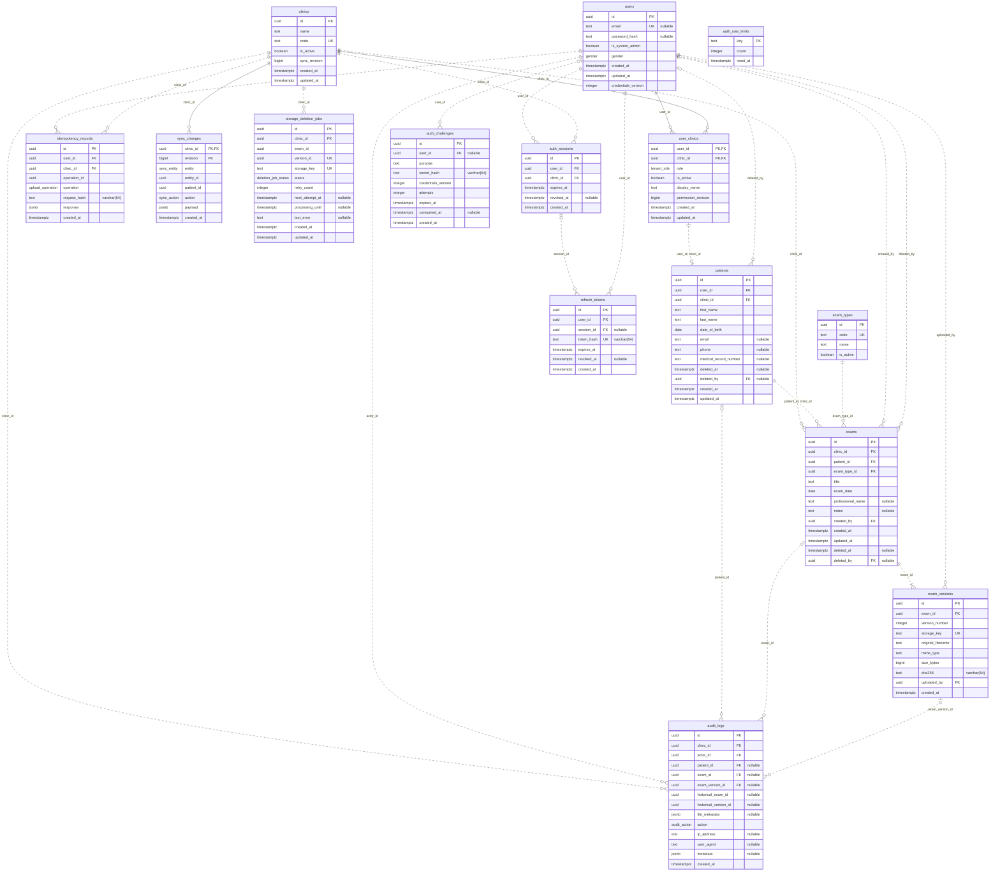
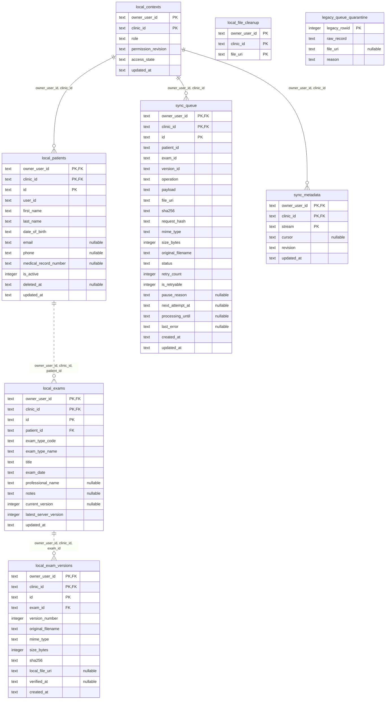

# Modelo de base de datos de WellQ

Modelo derivado del código del repositorio al 11 de noviembre de 2026. Documenta el esquema versionado; no se consultó una base desplegada.

Fuentes: [Prisma/PostgreSQL](../apps/api/prisma/schema.prisma), [migraciones](../apps/api/prisma/migrations/), [SQLite móvil v2](sqlite_mobile_schema.sql) y [contrato de persistencia](contracts/README.md).

## Vista general del dominio

La cuenta de acceso es global. La membresía define el rol en cada clínica y puede tener una ficha de paciente propia. Una cuenta puede tener fichas independientes en varias clínicas.

## Modelo completo PostgreSQL

Incluye todas las tablas y columnas de Prisma con sus nombres físicos SQL. `PK` indica clave primaria; `FK`, clave foránea; `UK`, unicidad individual. En claves compuestas, `PK` marca cada componente. Las restricciones únicas compuestas se detallan después del diagrama. `nullable` indica que la columna admite NULL. Los valores por defecto, índices y validaciones CHECK no se enumeran en los atributos.

Cardinalidades: `||` = exactamente uno; `o|` = cero o uno; `o{` = cero o muchos; `|{` = uno o muchos. La línea continua representa una relación identificadora (la FK integra la PK del hijo); la discontinua, una relación no identificadora. Ambas representan FKs reales.

La relación examen–versiones muestra el mínimo de una versión exigido por el constraint diferido de las migraciones, además de la FK.

### Unicidad compuesta PostgreSQL

| Tabla | Columnas UNIQUE |
|---|---|
| `patients` | `(user_id, clinic_id)` |
| `patients` | `(id, clinic_id)` |
| `patients` | `(clinic_id, medical_record_number)` |
| `exam_versions` | `(exam_id, version_number)` |
| `idempotency_records` | `(user_id, clinic_id, operation_id)` |

### Enumeraciones PostgreSQL

| Tipo | Valores |
|---|---|
| `tenant_role` | `CLINIC_ADMIN`, `CLINICIAN`, `PATIENT` |
| `gender` | `FEMALE`, `MALE`, `UNSPECIFIED` |
| `audit_action` | `CREATE`, `VIEW`, `DOWNLOAD`, `NEW_VERSION`, `UPDATE`, `DELETE`, `PURGE` |
| `upload_operation` | `CREATE_EXAM_WITH_VERSION`, `UPLOAD_VERSION` |
| `sync_entity` | `PATIENT`, `EXAM`, `EXAM_VERSION` |
| `sync_action` | `UPSERT`, `DELETE` |
| `deletion_job_status` | `PENDING`, `PROCESSING`, `FAILED`, `COMPLETED` |

## Reglas que complementan el diagrama

- `patients(user_id, clinic_id)` referencia a `user_clinics(user_id, clinic_id)`; no existe una tabla `patient_clinics`. La membresía admite como máximo una ficha de paciente.
- `exams(patient_id, clinic_id)` referencia a `patients(id, clinic_id)`, evitando asociar un examen a un paciente de otra clínica.
- `users.gender` es un atributo de la identidad global. El rol y la actividad dentro de una clínica pertenecen a `user_clinics`.
- Los pacientes y exámenes tienen eliminación lógica mediante `deleted_at` y `deleted_by`. Las membresías se desactivan y los pacientes se conservan físicamente.
- Cada versión representa un archivo inmutable en S3/MinIO; la base guarda su clave y metadatos. No hay una tabla de archivos ni contenido documental BLOB.
- Al purgar un examen, sus versiones se eliminan en cascada. Las FKs de `audit_logs` hacia examen y versión pasan a NULL; los UUID históricos y metadatos se conservan.
- `audit_logs.historical_exam_id` y `historical_version_id`; `sync_changes.entity_id` y `patient_id`; y `storage_deletion_jobs.exam_id` y `version_id` son identificadores históricos sin FK a esas entidades. Por eso no se dibujan relaciones para ellos.
- `auth_rate_limits` no declara FKs. `auth_challenges.user_id` y `refresh_tokens.session_id` son opcionales.
- Los triggers añaden reglas de coherencia y autorización que no se expresan completamente en un ERD. Véanse las migraciones y el contrato de persistencia.

## SQLite móvil: caché y sincronización

Es una base independiente del servidor. No hay FKs entre PostgreSQL y SQLite. Las columnas `owner_user_id` y `clinic_id` delimitan el contexto local; las relaciones compuestas conservan ese aislamiento. El diagrama se obtiene de las tablas y FKs del SQL v2 ejecutado en memoria.

### Unicidad compuesta SQLite

| Tabla | Columnas UNIQUE |
|---|---|
| `local_patients` | `(owner_user_id, clinic_id, user_id)` |
| `local_exam_versions` | `(owner_user_id, clinic_id, exam_id, version_number)` |
| `sync_queue` | `(owner_user_id, clinic_id, version_id)` |

`local_file_cleanup` y `legacy_queue_quarantine` no declaran FKs. La limpieza de archivos debe sobrevivir a la eliminación de caché; la cuarentena preserva registros antiguos sin atribuirles automáticamente propietario o clínica.

`sync_queue` referencia únicamente al contexto: sus identificadores de paciente, examen y versión no tienen FK a la caché, porque una carga pendiente puede corresponder a entidades todavía no confirmadas. Las credenciales se almacenan fuera de SQLite.

`local_exams.current_version` se deriva de las descargas verificadas; `latest_server_version` indica la última versión confirmada por el servidor. Los archivos físicos se referencian mediante URI.
